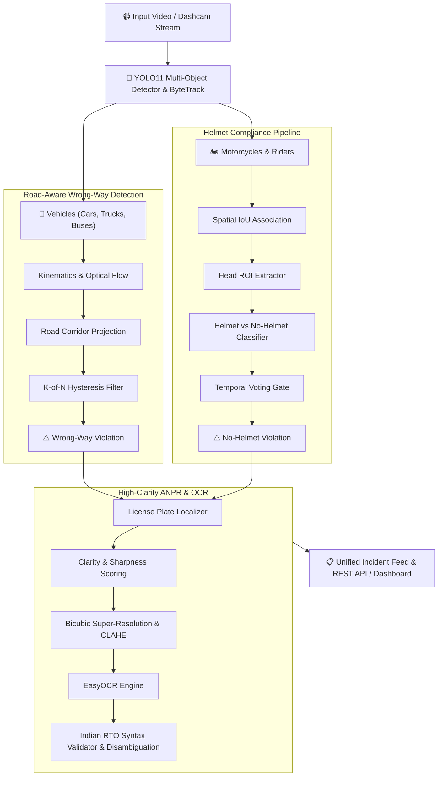
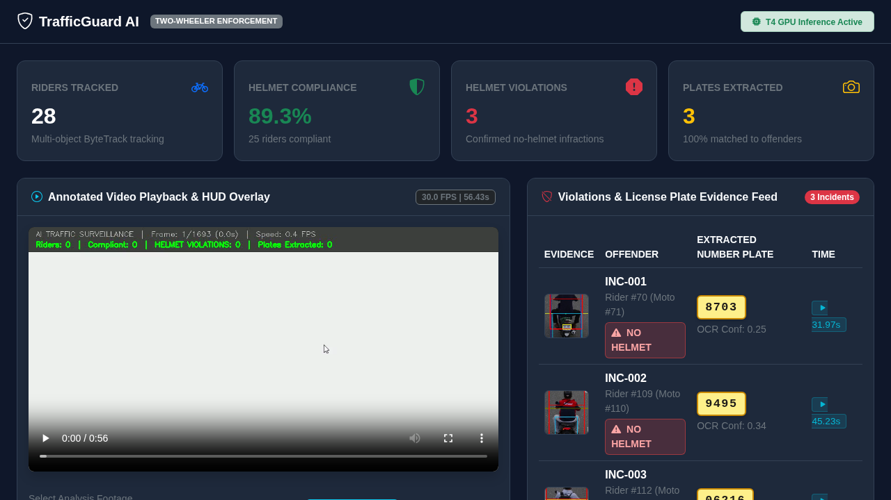

# 🚦 Smart Traffic Violation Detection & ANPR Platform

[](https://www.python.org/)
[](https://fastapi.tiangolo.com/)
[](https://docs.ultralytics.com/)
[](https://opensource.org/licenses/MIT)
[](tests/)

An end-to-end, real-time Computer Vision and Deep Learning traffic enforcement intelligence platform. It features multi-camera dashcam ingestion, ego-motion compensated wrong-way driving detection, motorcycle rider-passenger helmet violation association, and high-clarity Automatic Number Plate Recognition (ANPR) with Indian RTO syntax validation.

---

## 🌟 Key Highlights

- **🛣️ Ego-Compensated Wrong-Way Driving Detection:**
  Eliminates false alerts during lane-overtaking maneuvers by combining road corridor vector projection, ego-motion compensation, and a temporal hysteresis state machine (K-of-N frame confirmation).
- **🛵 Motorcycle Helmet Enforcement Engine:**
  Associates motorcycle track IDs with riders and passengers via spatial IoU intersection, tracks head ROIs, and applies temporal smoothing to confirm non-compliance.
- **🔍 High-Clarity ANPR & Super-Resolution:**
  Scores license plate image clarity (contrast, sharpness, edge density), applies 3x bicubic super-resolution, and reconstructs multi-line Indian license plates with OCR positional correction (e.g. `O` vs `0`, `I` vs `1`).
- **💻 Unified Enforcement Dashboard:**
  Built with FastAPI and modern UI: includes video playback speed controls (0.25x – 2.0x), live evidence feed, interactive threshold tuner, and 1-click audit trail export (JSON & CSV).
- **⚡ Dual-Engine Orchestration:**
  Supports local CPU inference runners as well as automated Google Colab GPU cloud orchestration with automatic VM teardown.

---

## 📐 Architecture Pipeline



---

## 📸 Dashboard Preview



---

## 🚀 Quickstart

### 1. Prerequisites
- Python 3.10+ (Python 3.11 recommended)
- `uv` (recommended) or `pip`
- Git

### 2. Installation

Clone repository:
```bash
git clone https://github.com/jeeva-m-21/traffic-violation-detector.git
cd traffic-violation-detector
```

Create virtual environment and install dependencies:
```bash
# Using uv (fastest)
uv venv
source .venv/bin/activate
uv pip install -r requirements.txt

# Or using standard pip
python3 -m venv .venv
source .venv/bin/activate
pip install -r requirements.txt
```

Set up environment variables:
```bash
cp .env.example .env
```

### 3. Run Unit Tests
```bash
python cli.py test
# or: python -m unittest discover tests
```
*Expected: 36/36 tests passing covering plate enhancer, syntax validator, wrong-way kinematics, helmet detector, and API.*

### 4. Launch the Web Dashboard
```bash
python cli.py web --reload
# or: uvicorn app:app --host 0.0.0.0 --port 8000 --reload
```
Navigate to `http://localhost:8000` in your browser.

---

## 🧪 CLI Pipelines & Inference

All pipelines can be run conveniently via the top-level `cli.py` runner or directly via `scripts/`:

### Local End-to-End Inference Runner
Run the CPU-optimized inference pipeline on test video:
```bash
python cli.py local
# or: python scripts/pipelines/run_local_inference.py
```

### Video Enforcement Pipelines
Execute dedicated video processing pipelines:
```bash
# Integrated Helmet + ANPR pipeline
python cli.py pipeline integrated
# or: python scripts/pipelines/run_integrated_pipeline.py

# Helmet violation detection only
python cli.py pipeline helmet
# or: python scripts/pipelines/run_helmet_pipeline.py

# ANPR and license plate recognition only
python cli.py pipeline anpr
# or: python scripts/pipelines/run_anpr_pipeline.py

# Road-aware wrong-way driving detection only
python cli.py pipeline wrongway
# or: python scripts/pipelines/run_violation_pipeline.py
```

### Remote Cloud / Colab GPU Orchestrators
```bash
# Orchestrate full pipeline on remote GPU with automated VM teardown
python cli.py orchestrate integrated
python cli.py orchestrate wrongway
python cli.py orchestrate plate-training
```

---

## 🌐 REST API Endpoints

| Method | Endpoint | Description |
|---|---|---|
| `GET` | `/` | Web enforcement UI dashboard |
| `GET` | `/api/violations` | Retrieve detected violation incidents with snapshot URIs |
| `GET` | `/api/metrics` | Summary metrics (total violations, helmet, wrong-way, ANPR confidence) |
| `GET` | `/api/settings` | Retrieve active detector and OCR threshold settings |
| `POST` | `/api/settings` | Dynamically tune thresholds (clarity score, confidence, IoU) |
| `GET` | `/api/export/csv` | Export violations as CSV audit sheet |
| `GET` | `/api/export/json` | Export violations as structured JSON log |
| `POST` | `/api/process` | Upload a video for pipeline analysis |

---

## 📁 Repository Structure

```
├── app.py                      # FastAPI web server and REST API
├── cli.py                      # Unified command-line interface
├── PRD.md                      # Product Requirements & Engineering Spec
├── backlog.md                  # Sprint tracker and backlog items
├── requirements.txt            # Python dependencies
├── .env.example                # Example environment configuration
├── config/
│   └── settings.json           # Runtime thresholds and configurations
├── notebooks/                  # Interactive Colab / Jupyter research notebooks
│   └── traffic_violation_m1.ipynb
├── scripts/                    # CLI execution and orchestration scripts
│   ├── pipelines/              # Video detection and inference pipelines
│   │   ├── run_integrated_pipeline.py
│   │   ├── run_local_inference.py
│   │   ├── run_helmet_pipeline.py
│   │   ├── run_anpr_pipeline.py
│   │   └── run_violation_pipeline.py
│   ├── orchestration/          # Automated remote Colab GPU lifecycle orchestrators
│   │   ├── orchestrate_integrated.py
│   │   ├── orchestrate_helmet.py
│   │   ├── orchestrate_anpr.py
│   │   ├── orchestrate_violation.py
│   │   └── orchestrate_plate_training.py
│   └── benchmarks/             # Dataset sampling, model training, and evaluations
│       ├── train_plate_detector.py
│       ├── step1_fetch_and_sample.py
│       ├── step2_run_models_and_eval.py
│       └── generate_notebook.py
├── src/                        # Core modular Python package
│   ├── anpr/                   # Plate enhancement, multi-line OCR, RTO syntax
│   ├── violations/             # Helmet detection, wrong-way kinematics, road segmenter
│   └── pipeline/               # Integrated violation-to-plate event engine
├── templates/
│   └── index.html              # Modern dark-mode dashboard interface
├── static/                     # Evidence snapshots, CSS assets, preview images
├── tests/                      # Automated test suite (36 unit tests)
└── results/                    # Validation benchmarks, reports, and JSON audits
└── run_*.py                    # Pipeline execution scripts
```

---

## 📄 License
This project is licensed under the MIT License. See [LICENSE](LICENSE) for details.
